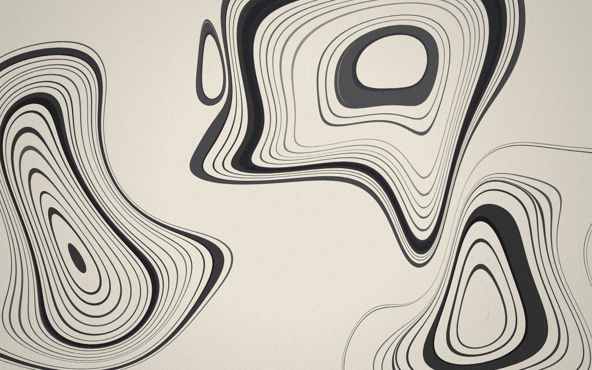
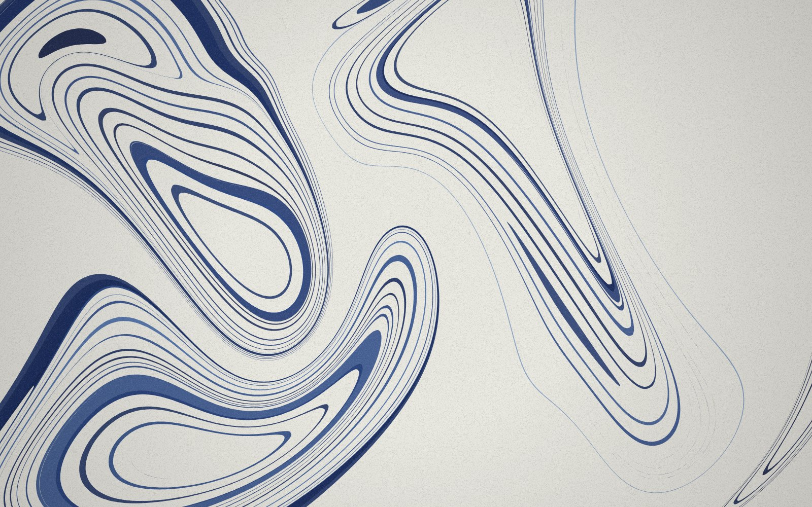
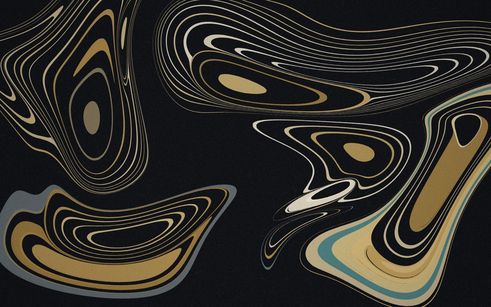
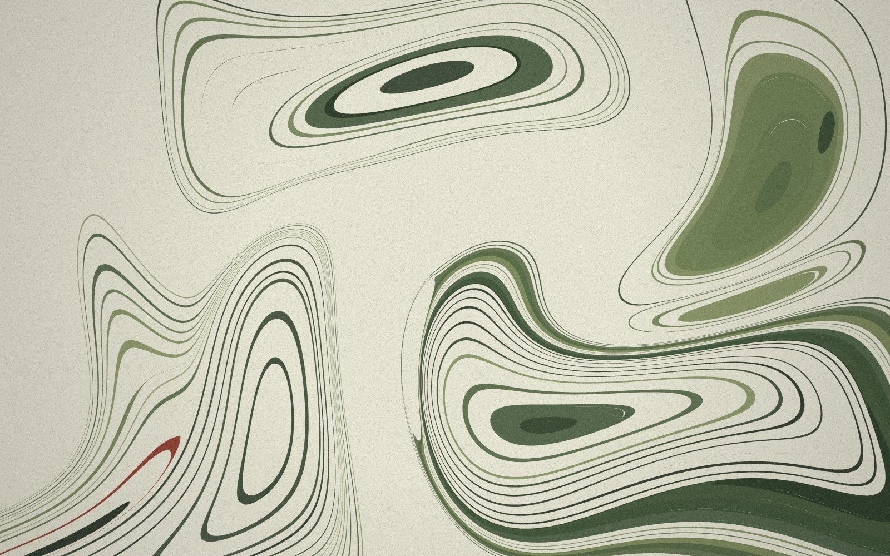

# Art of p5.js

p5.js で作るジェネラティブアート（プログラムが自動で描く絵）の作品集です。

## 墨流し (Suminagashi)



水面に墨を落として模様を作る日本の伝統技法「墨流し」を、p5.js で再現した作品です。
筆が墨と透明な液を交互に落として同心の輪を作り、風が水面をゆらして模様を育て、
最後に紙へ写し取って次の一枚へ進みます。一枚ごとに模様は変わり、同じものは二度と出ません。

| 藍 | 夜 | 苔 |
| --- | --- | --- |
|  |  |  |

### 見かた

`index.html` をブラウザで開くだけです（p5.js とフォントをインターネットから読み込むので、ネット接続が必要です）。

うまく開けないときは、このフォルダで簡易サーバーを立ててください。

```sh
python3 -m http.server 8000
# → ブラウザで http://localhost:8000 を開く
```

### 遊びかた

| 操作 | 起きること |
| --- | --- |
| クリック / タップ | その場所に墨が一滴落ちる |
| 押しっぱなし | 墨と透明な液が交互に落ちて、輪が重なっていく |
| ドラッグ / なぞる | 水面をかき混ぜる |
| `N` または「新しい紙」 | 次の一枚へ（墨 → 藍 → 夜 → 苔 の順に配色が変わる） |
| `スペース` または「止める」 | 風と自動の進行を止める / 再開する |
| `S` または「保存」 | いまの一枚を PNG 画像で保存 |
| `H` | 文字やボタンを隠す / 出す |

OS の「視差効果を減らす（動きを減らす）」設定がオンのときは、動きを見せずに仕上がった一枚を静止画で表示します。

### しくみ

- **輪は多角形**: 墨の輪はすべて「頂点の列」として持っています。
- **しずくは周りを押しのける**: 水は縮まないので、新しいしずくが半径 `r` まで広がると、
  中心から距離 `d` にあった点は `√(d² + r²)` の位置へ動きます。面積が保たれるので、外側の輪ほど細くなります。
- **風は湧き出しのない流れ**: 向きと波長のちがう波を 4 つ重ねた「流れ関数」から速度を作っています。
  水が増えも減りもしない流れなので、模様がつぶれず、なめらかに伸びていきます。
- **頂点の足し引き**: 輪郭は「頂点を通るなめらかな曲線」として描きます。頂点は、まっすぐな所ではまばらに、
  曲がりのきつい所でだけ細かく置くので、少ない頂点でなめらかな線になります。
- **紙の質感**: 細かい粒と繊維を描いた一枚の画像を、作品の上に重ねています。

### 軽く動かすための工夫

- **輪の部分だけを塗る**: 透明な液の部分は「穴」としてくり抜き、墨の輪だけを塗ります。
- **紙の質感は一度だけ描く**: 別のキャンバスに描いて重ねておき、毎コマ描き直しません。
- **止まっているときは何もしない**: 水面が静かなあいだは、計算も描き直しもしません。
- **端末に合わせて細かさを自動調整**: コマ落ちが続くと、まず画面の細かさ、次に線の細かさを一段ずつ下げます。

### ファイル

| ファイル | 役割 |
| --- | --- |
| `index.html` | ページ本体 |
| `sketch.js` | p5.js のスケッチ（作品のすべての動き） |
| `style.css` | 題名の札とボタンの見た目 |
